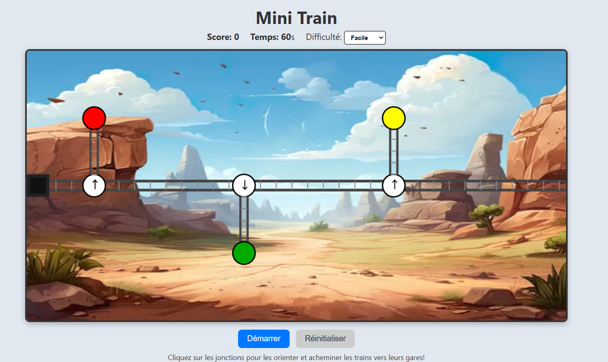
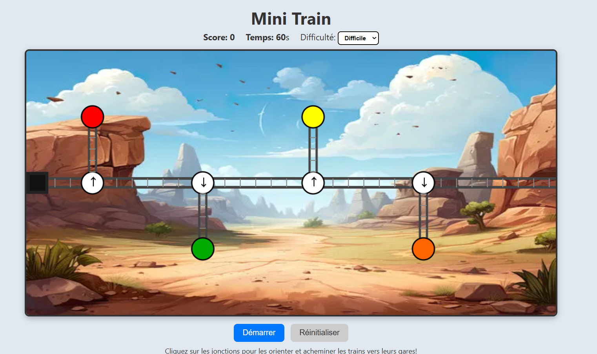

#  Mini Train

Jeu de réflexe et d'attention en JavaScript, réalisé en deuxième année de licence informatique.

Des trains de couleur sortent d'un tunnel et roulent sur une voie principale. Le joueur oriente les jonctions pour envoyer chaque train vers la gare de sa couleur avant la fin du chrono.



## Règles

- Une partie dure **60 secondes**.
- Chaque jonction a deux positions : **vers sa gare** (flèche verticale) ou **tout droit** (flèche horizontale). Un clic change la position.
- La position est lue au moment où le train passe sur la jonction.
- Un train qui arrive dans la gare de **sa couleur** rapporte **1 point**. Un train envoyé dans une mauvaise gare, ou qui sort de l'écran, ne rapporte rien.

## Difficultés

| | Facile | Moyen | Difficile |
|---|---|---|---|
| Jonctions / gares | 2 | 3 | 4 |
| Vitesse des trains | 42 px/s | 60 px/s | 81 px/s |
| Un nouveau train toutes les | 3 s | 2 s | 1,2 s |
| Écart minimum entre deux trains | 140 px | 110 px | 85 px |



## Lancer le jeu

Aucune installation n'est nécessaire : le jeu est en JavaScript sans bibliothèque.

1. Cloner le dépôt :
   ```bash
   git clone https://github.com/qlspanda17/JEUX_TRAIN_projet.git
   ```
2. Ouvrir `index.html` dans un navigateur, ou lancer un petit serveur local (par exemple l'extension **Live Server** de VS Code).

## Structure du projet

```
├── index.html             Page du jeu (canvas, score, chrono, boutons)
├── styles.css             Mise en page
├── lance.js               Point d'entrée : crée le jeu au chargement de la page
├── ok.webp                Image de fond
├── images/                Captures d'écran
└── js/
    ├── class_minitrain.js Boucle de jeu, chrono, score, apparition des trains
    ├── class_carte.js     Génère et dessine la voie, les jonctions et les gares
    ├── class_jonction.js  Aiguillage cliquable et voie vers sa gare
    ├── class_gare.js      Gare de destination d'une couleur
    └── class_train.js     Déplacement d'un train sur la voie ou vers une gare
```

## Points techniques

- Rendu sur un `<canvas>` HTML5 à l'aide de `requestAnimationFrame`.
- Programmation orientée objet avec des classes JavaScript.
- Déplacement basé sur le temps écoulé entre deux images (*delta time*) : les trains vont à la même vitesse quelle que soit la fréquence de l'écran (60, 120, 144 Hz…).
- Les clics sont convertis en coordonnées du canvas, ce qui permet au jeu de rester jouable quand la page est redimensionnée.
- Si l'image de fond ne se charge pas, le jeu affiche un fond uni au lieu de planter.
